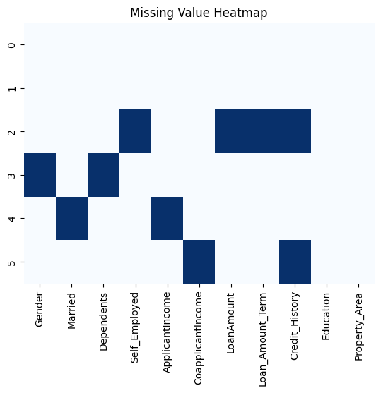
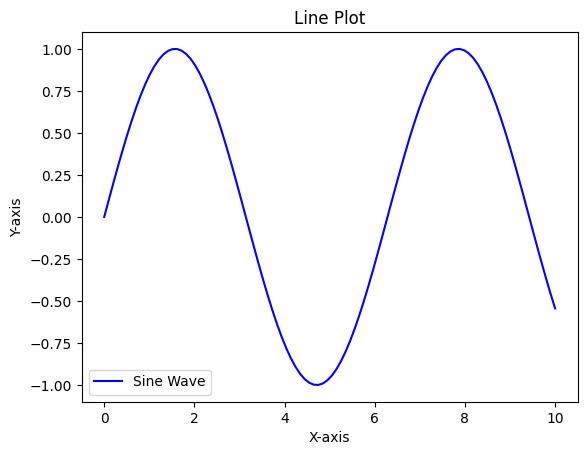
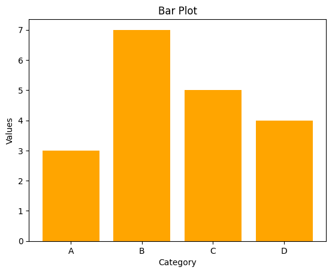
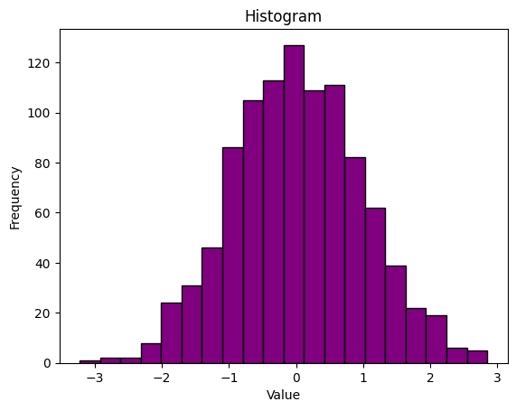
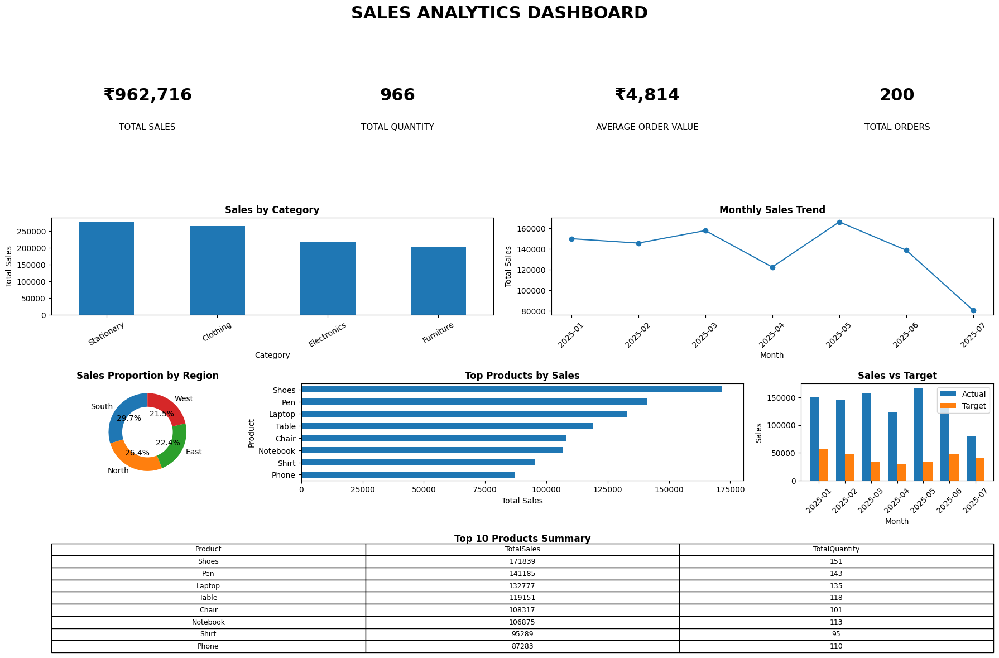
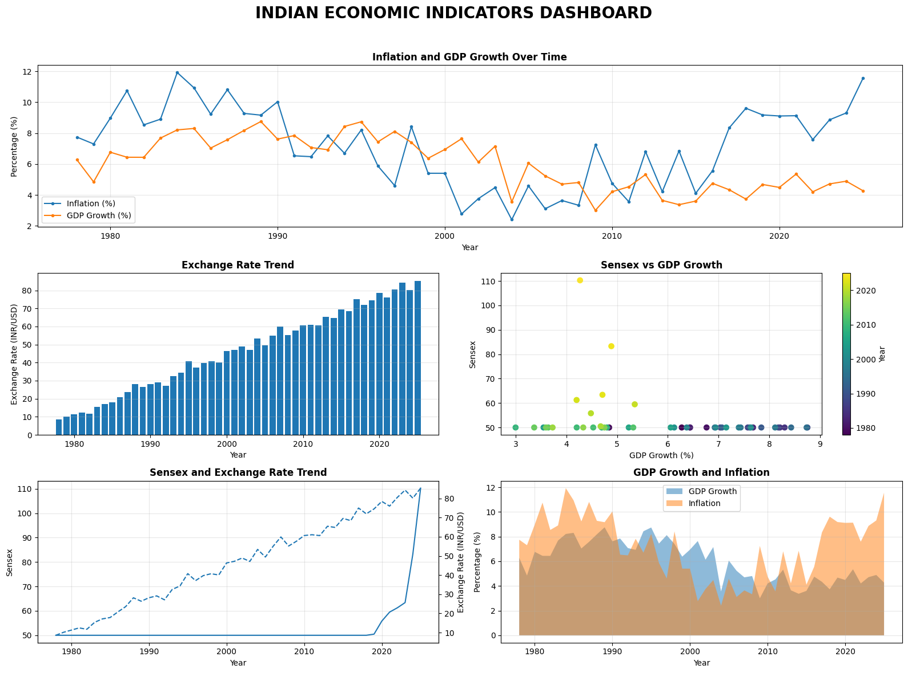

# Data Analytics and Visualization Laboratory

[](https://www.python.org/)
[](https://pandas.pydata.org/)
[](https://matplotlib.org/)
[](https://seaborn.pydata.org/)
[](#)

## 1. Project Title
**Data Analytics and Visualization Laboratory: Exploratory Analysis, Data Wrangling, and Executive Visual Dashboards**

## 2. Project Overview
This repository contains a full laboratory portfolio for the **Framework for Data and Visual Analytics** course. It covers the end-to-end data analytics lifecycle: from heterogeneous data ingestion (CSV, Excel spreadsheets, and web scraping) and data hygiene/wrangling routines to in-depth statistical exploratory data analysis (EDA), interactive Jupyter widget systems, and structured composite visual dashboards.

The lab culminates in the engineering of high-density executive analytics dashboards—such as a Python-rendered Power BI-equivalent sales analytics interface and a macroeconomic indicators tracking system—built using advanced sub-grid layouts, dual-axis plotting, and aesthetic color palettes.

---

## 3. Objectives
- Establish robust multi-source data ingestion pipelines capable of parsing CSV, multi-sheet Excel files, and HTML tables.
- Build interactive user-driven analysis tools in notebooks using `ipywidgets` dynamic callbacks.
- Conduct thorough statistical profiling, missing data diagnosis, and outlier detection across tabular datasets.
- Implement data transformation, type-casting, imputation, and feature engineering for domain-specific tabular datasets (such as banking loan portfolios).
- Master univariate, bivariate, and multivariate visual analytics using Matplotlib and Seaborn.
- Architect executive visual dashboards adhering to modern data storytelling principles, layout symmetry, and color theory.

---

## 4. Key Features
- **Multi-Source Data Loading**: Handlers for delimited text files, Microsoft Excel formats (`openpyxl`), and online HTML tables (`lxml`/`BeautifulSoup`).
- **Interactive UI Components**: Real-time reactive notebook widgets enabling parameter tuning without cell re-execution.
- **Statistical EDA Framework**: Comprehensive distributional assessment through five-number summaries, skewness, interquartile ranges, and correlation matrices.
- **Data Wrangling & Imputation**: Strategies for missing data handling (mean/median/mode imputation, deterministic filling, and deletion) applied to financial records.
- **Modular Dashboard Architecture**: Multi-axis, sub-grid layouts utilizing `matplotlib.pyplot.subplot2grid` and `GridSpec` for synchronized multi-panel time-series analysis.
- **Power BI / Tableau Replication**: Pure Python implementations of standard corporate business intelligence reports.

---

## 5. Technologies Used
- **Programming Language**: Python 3.10+
- **Data Manipulation & Analysis**: Pandas, NumPy
- **Data Visualization**: Matplotlib, Seaborn
- **File & Web Parsing**: Openpyxl, LXML, BeautifulSoup4
- **Interactive Computing**: IPywidgets, Jupyter Notebook

---

## 6. Project Structure
```text
Framework-for-Data-and-Visual-Analytics/
│
├── FDVA_EXP_1.ipynb        # Experiment 1: Interactive Widgets and Event-Driven UI Controls
├── FDVA_EXP_2.ipynb        # Experiment 2: Multi-Source Data Ingestion (CSV, Excel, Web Tables)
├── FDVA_EXP_3.ipynb        # Experiment 3: Exploratory Data Analysis & Statistical Profiling
├── FDVA_EXP_4.ipynb        # Experiment 4: Data Cleaning, Formatting, and Loan Dataset Wrangling
├── FDVA_EXP_5.ipynb        # Experiment 5: Statistical Data Visualization Techniques
├── FDVA_EXP_6.ipynb        # Experiment 6: Enterprise Sales Analytics Dashboard (Power BI Style)
├── FDVA_EXP_7.ipynb        # Experiment 7: Macroeconomic Multi-Indicator Financial Dashboard
│
├── docs/
│   └── images/             # Extracted empirical visualization outputs and dashboards
│       ├── fdva_exp_3_plot_1.png
│       ├── fdva_exp_5_plot_1.png
│       ├── fdva_exp_5_plot_2.png
│       ├── fdva_exp_5_plot_3.png
│       ├── fdva_exp_6_plot_1.png
│       └── fdva_exp_7_plot_1.png
│
└── README.md
```

---

## 7. Installation and Prerequisites
### Prerequisites
- Python 3.10 or higher
- Jupyter Notebook or JupyterLab

### Environment Setup
```bash
python -m venv venv
# On Windows:
venv\Scripts\activate
# On Linux/macOS:
source venv/bin/activate
```

### Install Required Libraries
```bash
pip install pandas numpy matplotlib seaborn ipywidgets openpyxl lxml beautifulsoup4 jupyter
```

---

## 8. Execution Instructions
Launch the notebook environment:
```bash
jupyter notebook
```
Open each notebook (`FDVA_EXP_1.ipynb` to `FDVA_EXP_7.ipynb`) and select **Kernel $\to$ Restart & Run All**.

---

## 9. Implementation and Methodology

| Exp No. | Experiment Focus | Analytical Techniques & Methods | Dataset / Domain | Key Outputs |
|---|---|---|---|---|
| **01** | Interactive Controls | `ipywidgets.IntSlider`, `Output` widget observer events, state binding | Synthetic Parameter Space | Dynamic interactive text feedback |
| **02** | Heterogeneous Ingestion | `pd.read_csv`, `pd.read_excel`, `pd.read_html` web table scraping | Structured Web & File Sources | Unified tabular representations |
| **03** | Exploratory Data Analysis | Central tendency, dispersion, quantile analysis, distribution histograms | Tabular Demographic Data | Summary tables and distribution curves |
| **04** | Data Hygiene & Wrangling | Null imputation, type conversions, range filtering, outlier truncation | Financial Loan Applications | Cleaned, analysis-ready tabular dataset |
| **05** | Statistical Visuals | Line charts, Categorical bar plots, Scatter plots, Box & Whisker plots | Multi-attribute Datasets | Distributional and relationship charts |
| **06** | BI Sales Dashboard | Subplot2Grid layout, monthly sales trajectory, regional share, profit analysis | Retail Sales & Transactions | Executive commercial BI dashboard |
| **07** | Economic Dashboard | Dual-axis (`twinx`), area fills, multi-panel temporal correlation | Macroeconomic Indicators (GDP, CPI, INR/USD, Sensex) | Comprehensive macro financial dashboard |

---

## 10. Results and Outputs
- **Experiment 1**: Enabled smooth client-side interaction in notebooks, allowing dynamic filtering without regenerating the entire execution state.
- **Experiment 2**: Successfully extracted and regularized data across three distinct formats into unified Pandas DataFrames with identical column metadata.
- **Experiment 3 & 4**: Identified distribution skewness and addressed data quality gaps in loan portfolios through robust statistical imputation.
- **Experiment 5**: Illustrated key relationships between variables through multivariate visual encodings.
- **Experiment 6 & 7**: Generated publication-quality visual dashboards with custom typography, clean grid alignments, and high readability for data reporting.

---

## 11. Screenshots and Visual Outputs

### Experiment 3: Exploratory Data Distribution Analysis


### Experiment 5: Core Statistical Visualizations (Line, Bar, Scatter)




### Experiment 6: Executive Sales Analytics Dashboard (Power BI Style Layout)


### Experiment 7: Macroeconomic Multi-Panel Indicators Dashboard


---

## 12. Learning Outcomes
- Acquired proficiency in transforming raw tabular and unstructured data into curated, analysis-grade datasets.
- Mastered advanced layout primitives in Matplotlib (`Subplot2Grid`, `GridSpec`, `twinx`) to design composite visual reports.
- Developed an understanding of visual perception principles, including effective color palettes, chart selection criteria, and label hierarchy.
- Gained experience creating interactive analytical workflows within the Jupyter ecosystem.

---

## 13. Future Improvements
- Migrate static dashboards into interactive web-native applications using Streamlit or Dash.
- Connect ingestion pipelines directly to live SQL databases and RESTful JSON APIs.
- Incorporate automated anomaly detection and time-series decomposition (trend, seasonality, noise).
- Implement interactive filtering using Plotly or Altair for browser-based tooltips and zooming.

---

## 14. Author
**Rohita M**  
- **GitHub**: [@rohitam26](https://github.com/rohitam26)  
- **Academic Program**: B.E. Artificial Intelligence and Machine Learning  
- **Institution**: Rajalakshmi Engineering College  
